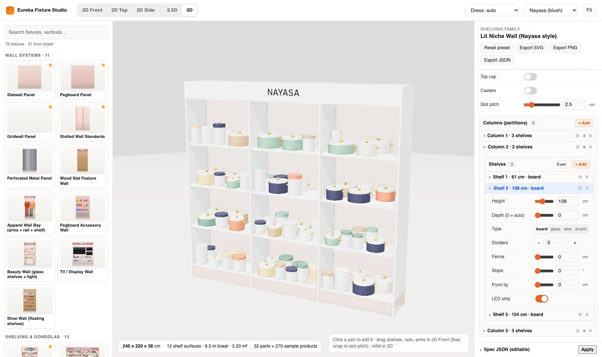
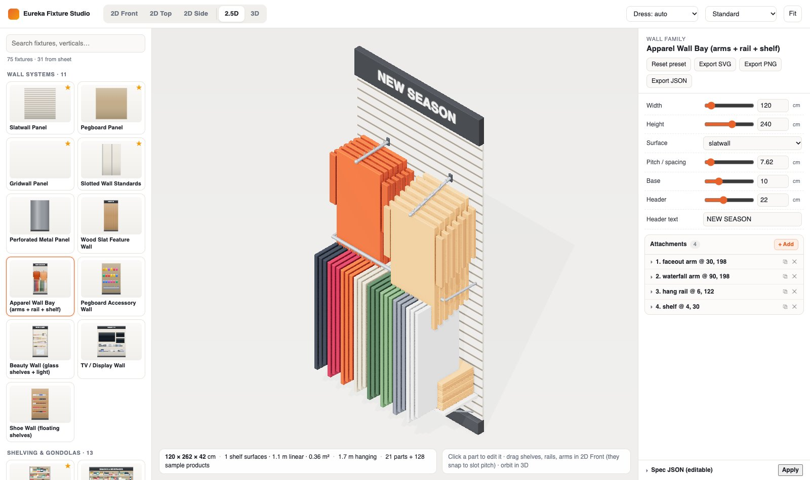
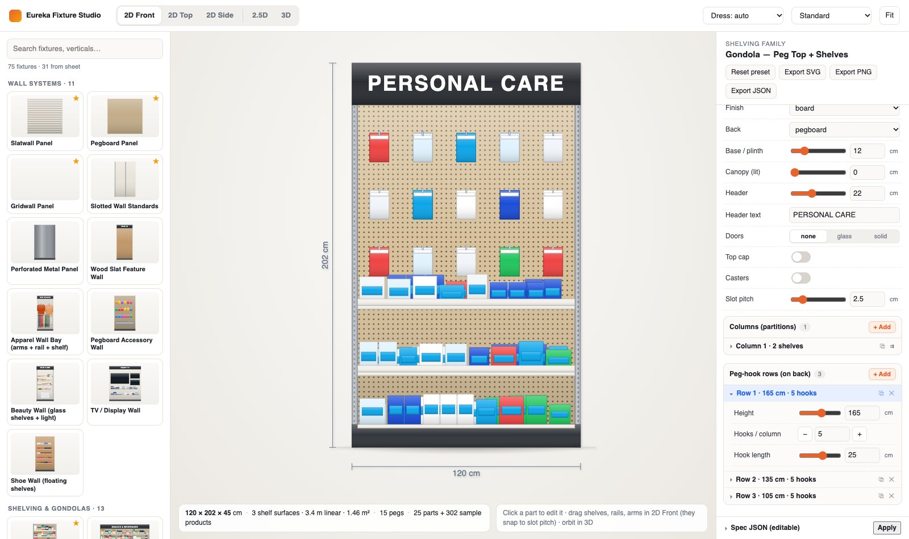

# Eureka Fixture Library

A parametric retail fixture library and studio for planograms. Every fixture is
**data** (an editable JSON spec in centimetres) drawn by code, so there are no
fixture images to produce, and 2D, 2.5D and 3D can never disagree.

- **75 fixtures across 13 verticals**: apparel, footwear, grocery, beauty,
  pharmacy, electronics, home/crockery, jewellery, eyewear, books, liquor, toys
  and bakery. ★ marks the 31 fixtures from `eureka_fixtures.xlsx`.
- **5 views from one model**: 2D front / top / side elevations (SVG), 2.5D
  isometric, and 3D orbit (three.js, PBR, soft shadows, ambient occlusion).
- **Everything editable**: dimensions, partitions (columns), and per-shelf height,
  depth, type, dividers, fence, slope, lip and LEDs. Also peg-hook rows, rack arms,
  rails, wall attachments, doors, canopies, casters and themes. You can drag
  shelves, rails, arms and attachments in 2D front view, and they snap to the
  real slot pitch.
- **Dressed with sample merchandise** per vertical, so every fixture reads
  instantly. The same merchandising *surfaces* are what a planogram engine fills
  with real SKUs.



| 2.5D | 2D front |
|---|---|
|  |  |

Full library: [3D](docs/screenshots/library-3d.jpg) · [2D front](docs/screenshots/library-2d-front.jpg)

## Run it

```bash
npm install
npm run dev        # http://localhost:8765
npm run build      # static site in dist/ (index.html + app.js), deploy anywhere
npm run typecheck
```

Handy URL parameters:

- `?p=<preset id>&view=front|top|side|iso|3d&theme=standard|nayasa|noir&dress=<vertical>`
- `?sheet=front` or `?sheet=3d` renders the whole library as a contact sheet.
- `?q=low` turns off ambient occlusion, for slow GPUs.

## How it works

```
FixtureSpec (JSON, cm) ──buildFixture()──▶ Parts[] + Surfaces[]
                                            │          │
                       render2D() ◀─────────┤          └─▶ dress()  → sample products (Parts)
                       (front/top/side SVG) │
                       Viewer3D   ◀─────────┘   (2.5D iso camera / 3D orbit camera)
```

| File | Role |
|---|---|
| `src/model.ts` | Part types (box, cylinder, sphere, wire, ring), materials and themes, bounds |
| `src/families.ts` | The 6 parametric families: **shelving**, **rack**, **table**, **wall**, **bin**, **hardware**. Each emits geometry plus merchandising surfaces. |
| `src/catalog.ts` | 75 presets. A new fixture is usually a new preset, not new code. |
| `src/schema.ts` | Editor schema per family. The properties panel is generated from it. |
| `src/dress.ts` | Vertical-specific sample merchandise for the surfaces |
| `src/view2d.ts` | 2D projections: depth-sorted, shaded, patterned, with dimension lines |
| `src/view3d.ts` | three.js: environment lighting, PBR, shadows, GTAO, procedural textures |
| `src/app.ts` | Studio UI: catalog, views, generated form, drag-to-edit, export (SVG/PNG/JSON) |

### Adding a fixture

1. If an existing family can express it, add a preset to `src/catalog.ts`.
2. If it needs a new option (say, a shelf type), add the field to the family spec,
   handle it in `families.ts`, and add one line to `schema.ts`. Every view picks
   it up automatically.

## Known limits

- Sample products are procedural shapes. Real SKUs (photo cut-outs at true cm
  size) are the next layer.
- Mannequins/forms are out of scope for v1, per the fixture audit.
- Fixtures are shown one at a time. Placing them on a store floor plan is a separate step.
